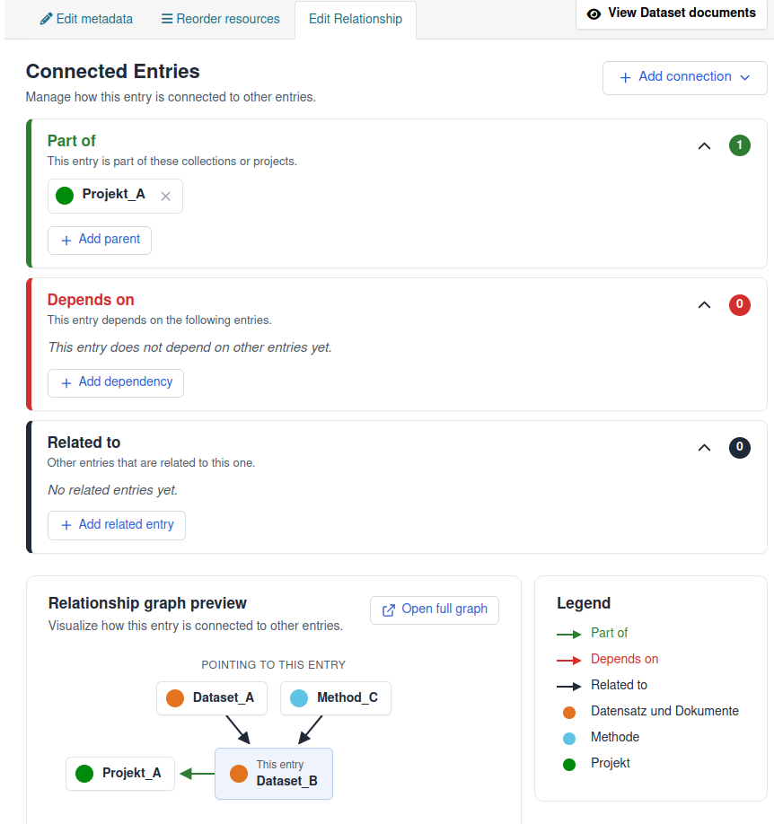
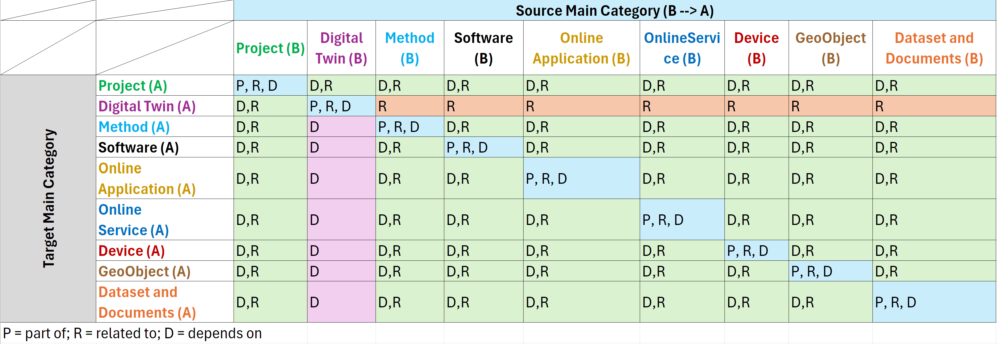

ckanext-relation
=====================

Overview
------------

This extension provides a UI for creating, deleting, and viewing relationships between datasets in a CKAN catalog. It is specifically designed for the [Smart District Data Infrastructure (SDDI)](https://github.com/tum-gis/SDDI-CKAN-Docker) and the requirements of [HEF, TUM](http://www.hef.wzw.tum.de/).


Key features:

- **Relationship editor** — an *Edit Relationship* tab on every catalog entry lets users add and remove connections of three types: *Part of*, *Depends on*, and *Related to*.
- **Inline search** — entries can be found by clicking on *Search*.
- **Relationship graph preview** — a compact node-and-arrow diagram shows all direct connections at a glance. A full interactive graph is available via *Open full graph*.
- **Category colours** — when used together with [ckanext-grouphierarchy-sddi](https://github.com/tum-gis/ckanext-grouphierarchy-sddi), each entry node is coloured according to its main category matching the colours used throughout the catalog.
- **OCL rule enforcement** — relationship constraints from the SDDI data model are enforced both in the UI and through the API (see [Relationship rules](#relationship-rules) below).



------------------
Relationship types
------------------

Relationships are edited on the **Edit Relationship** tab of a catalog entry. There are three types:

| Type | Shown as | Meaning | Colour |
|---|---|---|---|
| `child_of` | **Part of** | This entry is part of another entry, e.g. a sub-project of a project. | green |
| `depends_on` | **Depends on** | This entry needs another entry, e.g. input data or a method. | red |
| `links_to` | **Related to** | This entry is related to another entry, but not part of a hierarchy. | black |

CKAN also stores each relationship in the opposite direction (`parent_of`, `dependency_of`, `linked_from`). These incoming relationships are shown in the graph, and the rules below apply to them as well.

------------------
Relationship rules
------------------

Which relationships are allowed depends on the **main category** of the catalog entries, e.g. *Projekt* or *Digitaler Zwilling* (the child groups of the `main-categories` group). The rules come from OCL invariants of the SDDI data model.

### `SameCategoryPartOf` (All categories)

**Part of** (`child_of`) relations can only be created between entries of the same main category. For example, a Software entry can only be part of another Software entry, a Projekt entry can only be part of another Projekt entry, and so on.

### `ChildOfMeansSubprojectToParent` (Project)

A Project can only be **Part of** another Project. A sub-project always belongs to a parent project, never to another kind of entry.

```
context Project
inv ChildOfMeansSubprojectToParent:
  self.relation
    ->select(r | r.oclIsKindOf(InternalLink))
    ->select(r | r.type = RelType::child_of)
    ->forAll(r |
      let l : InternalLink = r.oclAsType(InternalLink) in
        l.target.oclIsKindOf(Project) and l.target <> self
    )
```

### `OutgoingConstraints` (Digital Twin)

A Digital Twin:

- can **depend on** entries of any category,
- can be **related to** Digital Twins and Projects only,
- can be **part of** another Digital Twin only (same-category rule).

```
context DigitalTwin
inv OutgoingConstraints:
  self.relation->select(r | r.oclIsKindOf(InternalLink))
    ->forAll(r |
      let il : InternalLink = r.oclAsType(InternalLink) in
        -- no self-loop
        il.target <> self and
        (
          (il.target.oclIsKindOf(DigitalTwin) implies
              (il.type = RelType::links_to or il.type = RelType::depends_on))
          and
          (il.target.oclIsKindOf(Project) implies
              (il.type = RelType::links_to or il.type = RelType::depends_on))
          and
          ((not il.target.oclIsKindOf(DigitalTwin) and not il.target.oclIsKindOf(Project)) implies
              il.type = RelType::depends_on)
        )
    )
```

### `MethodOutgoingRelations` (Method)

A Method:

- can be **part of**, **depend on**, or **be related to** another Method,
- can only be **related to** a Digital Twin (not **depend on** it),
- can **depend on** or **be related to** entries of all other categories,
- can be **part of** another Method only (same-category rule).

```
context Method
inv MethodOutgoingRelations:
  self.relation->select(r | r.oclIsKindOf(InternalLink))
    ->forAll(r |
      let il : InternalLink = r.oclAsType(InternalLink) in
        if il.target.oclIsKindOf(Method) then
          il.type = RelType::part_of or
          il.type = RelType::related_to or
          il.type = RelType::depends_on
        else if il.target.oclIsKindOf(DigitalTwin) then
          il.type = RelType::related_to
        else
          il.type = RelType::depends_on or
          il.type = RelType::related_to
        endif endif
    )
```

### `SoftwareOutgoingRelations` (Software)

A Software entry:

- can be **part of**, **depend on**, or **be related to** another Software entry,
- can only be **related to** a Digital Twin (not **depend on** it),
- can **depend on** or **be related to** entries of all other categories,
- can be **part of** another Software entry only (same-category rule).

```
context Software
inv SoftwareOutgoingRelations:
  self.relation->select(r | r.oclIsKindOf(InternalLink))
    ->forAll(r |
      let il : InternalLink = r.oclAsType(InternalLink) in
        if il.target.oclIsKindOf(Software) then
          il.type = RelType::part_of or
          il.type = RelType::related_to or
          il.type = RelType::depends_on
        else if il.target.oclIsKindOf(DigitalTwin) then
          il.type = RelType::related_to
        else
          il.type = RelType::depends_on or
          il.type = RelType::related_to
        endif endif
    )
```

### `OnlineApplicationOutgoingRelations` (Online Application)

An Online Application:

- can be **part of**, **depend on**, or **be related to** another Online Application,
- can only be **related to** a Digital Twin (not **depend on** it),
- can **depend on** or **be related to** entries of all other categories,
- can be **part of** another Online Application only (same-category rule).

```
context OnlineApplication
inv OnlineApplicationOutgoingRelations:
  self.relation->select(r | r.oclIsKindOf(InternalLink))
    ->forAll(r |
      let il : InternalLink = r.oclAsType(InternalLink) in
        if il.target.oclIsKindOf(OnlineApplication) then
          il.type = RelType::part_of or
          il.type = RelType::related_to or
          il.type = RelType::depends_on
        else if il.target.oclIsKindOf(DigitalTwin) then
          il.type = RelType::related_to
        else
          il.type = RelType::depends_on or
          il.type = RelType::related_to
        endif endif
    )
```

### `OnlineServiceOutgoingRelations` (Online Service)

An Online Service:

- can be **part of**, **depend on**, or **be related to** another Online Service,
- can only be **related to** a Digital Twin (not **depend on** it),
- can **depend on** or **be related to** entries of all other categories,
- can be **part of** another Online Service only (same-category rule).

```
context OnlineService
inv OnlineServiceOutgoingRelations:
  self.relation->select(r | r.oclIsKindOf(InternalLink))
    ->forAll(r |
      let il : InternalLink = r.oclAsType(InternalLink) in
        if il.target.oclIsKindOf(OnlineService) then
          il.type = RelType::part_of or
          il.type = RelType::related_to or
          il.type = RelType::depends_on
        else if il.target.oclIsKindOf(DigitalTwin) then
          il.type = RelType::related_to
        else
          il.type = RelType::depends_on or
          il.type = RelType::related_to
        endif endif
    )
```

### `DeviceOutgoingRelations` (Device)

A Device:

- can be **part of**, **depend on**, or **be related to** another Device,
- can only be **related to** a Digital Twin (not **depend on** it),
- can **depend on** or **be related to** entries of all other categories,
- can be **part of** another Device only (same-category rule).

```
context Device
inv DeviceOutgoingRelations:
  self.relation->select(r | r.oclIsKindOf(InternalLink))
    ->forAll(r |
      let il : InternalLink = r.oclAsType(InternalLink) in
        if il.target.oclIsKindOf(Device) then
          il.type = RelType::part_of or
          il.type = RelType::related_to or
          il.type = RelType::depends_on
        else if il.target.oclIsKindOf(DigitalTwin) then
          il.type = RelType::related_to
        else
          il.type = RelType::depends_on or
          il.type = RelType::related_to
        endif endif
    )
```

### `GeoObjectOutgoingRelations` (GeoObject)

A GeoObject:

- can be **part of**, **depend on**, or **be related to** another GeoObject,
- can only be **related to** a Digital Twin (not **depend on** it),
- can **depend on** or **be related to** entries of all other categories,
- can be **part of** another GeoObject only (same-category rule).

```
context GeoObject
inv GeoObjectOutgoingRelations:
  self.relation->select(r | r.oclIsKindOf(InternalLink))
    ->forAll(r |
      let il : InternalLink = r.oclAsType(InternalLink) in
        if il.target.oclIsKindOf(GeoObject) then
          il.type = RelType::part_of or
          il.type = RelType::related_to or
          il.type = RelType::depends_on
        else if il.target.oclIsKindOf(DigitalTwin) then
          il.type = RelType::related_to
        else
          il.type = RelType::depends_on or
          il.type = RelType::related_to
        endif endif
    )
```

### `DatasetAndDocumentsOutgoingRelations` (Dataset and Documents)

A Dataset and Documents entry:

- can be **part of**, **depend on**, or **be related to** another Dataset and Documents entry,
- can only be **related to** a Digital Twin (not **depend on** it),
- can **depend on** or **be related to** entries of all other categories,
- can be **part of** another Dataset and Documents entry only (same-category rule).

```
context DatasetAndDocuments
inv DatasetAndDocumentsOutgoingRelations:
  self.relation->select(r | r.oclIsKindOf(InternalLink))
    ->forAll(r |
      let il : InternalLink = r.oclAsType(InternalLink) in
        if il.target.oclIsKindOf(DatasetAndDocuments) then
          il.type = RelType::part_of or
          il.type = RelType::related_to or
          il.type = RelType::depends_on
        else if il.target.oclIsKindOf(DigitalTwin) then
          il.type = RelType::related_to
        else
          il.type = RelType::depends_on or
          il.type = RelType::related_to
        endif endif
    )
```

### No self-relationships (all categories)

An entry cannot be connected to itself (`l.target <> self` in the invariants above). This applies to all main categories.

### Overview



*P = Part of, D = Depends on, R = Related to. The diagonal (same category) always allows all three types. Source (B) is the entry initiating the relationship; Target (A) is the entry it points to.*

### How the rules are applied

- **On save:** every new relationship is checked, whether it is created on the Edit Relationship tab or through the API (`package_relationship_create`). A relationship that breaks a rule is rejected with a message, for example: *Entries of the category “Projekt” can only be part of entries of the category: “Projekt”.*
- **In the search:** when adding a connection, the search only offers entries that are allowed.
- **On the page:** each section of the Edit Relationship tab shows the rule that applies to the entry. If a type is not allowed at all, its *Add* button is hidden.
- **Several main categories:** if an entry has more than one main category, it must follow the rules of all of them. A target matches a rule if any of its main categories matches.
- **Existing relationships** are not changed. The rules only apply when a relationship is created.

### Adding or changing rules

The rules are defined in [`ckanext/relation/helpers.py`](ckanext/relation/helpers.py), using the main category names (e.g. `project`, `digital-twin`):

```python
# Relation types where subject and target must share at least one main category.
SAME_CATEGORY_TYPES = {"child_of"}

# subject category -> relation type -> main categories the target MUST have
RELATION_RULES = {
    "project": {"child_of": {"project"}},
    "digital-twin": {"child_of": set(), "links_to": {"digital-twin", "project"}},
}

# subject category -> relation type -> main categories the target must NOT have
# (violation shown as a hint in the UI)
EXCLUDED_TARGETS = {}

# Same as EXCLUDED_TARGETS but enforced silently — no hint shown in the UI
SILENT_EXCLUDED_TARGETS = {
    "method":   {"depends_on": {"digital-twin"}},
    "software": {"depends_on": {"digital-twin"}},
}
```

- A relation type that is not listed is allowed to any target.
- An empty set (`set()`) in `RELATION_RULES` means the type is not allowed for that category.
- `SAME_CATEGORY_TYPES` applies to all categories that do not already have an explicit `RELATION_RULES` entry for that type.

The check itself is in `relation_violation()`. It is called from the `package_relationship_create` action in [`ckanext/relation/actions.py`](ckanext/relation/actions.py).

------------
Requirements
------------

This extension is tested with CKAN 2.11.0.

------------
Installation
------------

To install ckanext-relation:

1. Activate your CKAN virtual environment, for example::

       . /usr/lib/ckan/default/bin/activate

2. Install the ckanext-relation Python package into your virtual environment::

       pip install -e 'git+https://github.com/tum-gis/ckanext-relation-sddi.git#egg=ckanext-relation-sddi'

3. Add ``relation`` to the ``ckan.plugins`` setting in your CKAN
   config file (by default the config file is located at
   ``/etc/ckan/default/production.ini``).

4. Restart CKAN. For example if you've deployed CKAN with Apache on Ubuntu::

       sudo service apache2 reload


---------------
Config settings
---------------

None at present


----------------------
Developer installation
----------------------

To install ckanext-relation for development, activate your CKAN virtualenv and
do::

    git clone https://github.com/tum-gis/ckanext-relation-sddi.git
    cd ckanext-relation
    python setup.py develop


--------
License
--------
The ckanext-relation is available as free and open source and is licensed under the [Apache License, Version 2.0](http://www.apache.org/licenses/LICENSE-2.0). 

